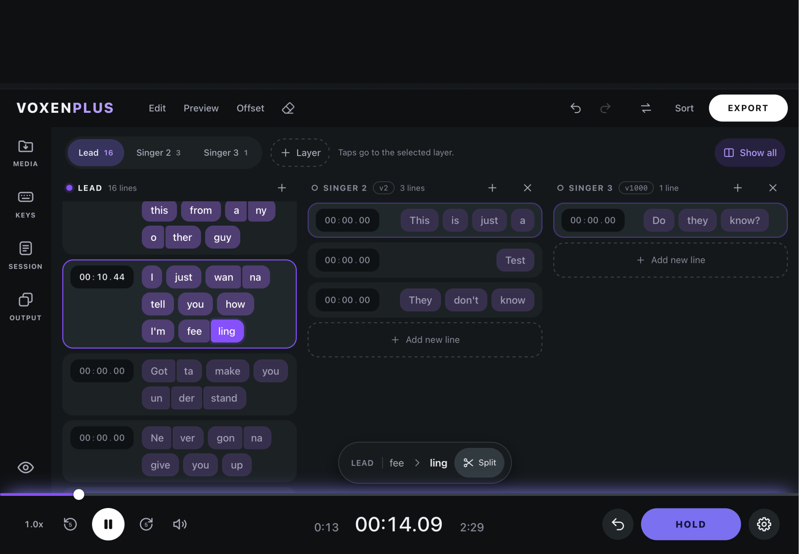

# 🎧 VoxenPlus — Advanced Synced Lyrics & LRC Editor

**VoxenPlus** is a free, lightweight, browser-based **synced lyrics editor** for creating precise **LRC files**, karaoke lyrics, and word-by-word or syllable-by-syllable lyric timing.

It is designed for people who want more control than a basic LRC editor provides, with support for **line timing, word timing, syllable timing, background vocals, up to three singers, duet lyrics, customizable keyboard controls and appearance, saved sessions, undo and redo, and multiple synchronization modes**.

VoxenPlus runs directly in your browser on **PC, iPad and mobile** with no installation required.

**Load your song. Add your lyrics. Sync them. Export your LRC (or JSON).**

> 🍴 **VoxenPlus is a fork of [Voxen](https://github.com/Raqhael-ux/Voxen-LRC-Editor) by [Raqhael-ux](https://github.com/Raqhael-ux)**, based on Voxen v9.2b. The original editor, its sync workflow and the `.vxn` project format come from Voxen. Please take a look at the original project too.

## 🌐 Try VoxenPlus Online

**[VoxenPlus Online](https://voxenplus1.vercel.app)**

No download or installation is required.

Prefer to run it locally? VoxenPlus is a single HTML file: download `index.html` from this repository and open it in your browser.

---

<p align="center">
  
</p>

---

## ⭐ VoxenPlus vs. Original Voxen

VoxenPlus is a fork of the original [Voxen](https://github.com/Raqhael-ux/Voxen-LRC-Editor) synced lyrics editor by [Raqhael-ux](https://github.com/Raqhael-ux). It keeps what Voxen does well and builds on it with syllable timing, a separate layer for every vocal part, undo and redo, a converter between Pro and Advanced, sessions that save themselves, a look you can customize, and more.

| Feature                                                    |    VoxenPlus    | Original Voxen  |
| ---------------------------------------------------------- | :-------------: | :-------------: |
| Line-by-line lyric timing                                  |        ✅        |        ✅        |
| Word-by-word lyric timing                                  |        ✅        |        ✅        |
| Syllable-by-syllable timing                                |        ✅        |        ❌        |
| Automatic syllable splitting                               |        ✅        |        ❌        |
| Manual syllable editing                                    |        ✅        |        ❌        |
| Merge and split syllables                                  |        ✅        |        ❌        |
| Background vocals                                          | ✅ (own layer)   | ✅ (line type)   |
| Multiple singers                                           |  ✅ (up to 3)    |  ✅ (up to 3)    |
| Every singer on a separate layer, shown side by side       |        ✅        |        ❌        |
| Tap sync mode                                              |        ✅        |        ✅        |
| Hold sync mode                                             |        ✅        |        ✅        |
| Hybrid sync mode                                           |        ✅        |        ✅        |
| Customizable keyboard controls                             |        ✅        |        ✅        |
| Remembers your keys, interface style, look and syllable fixes |     ✅        |        ❌        |
| Reaction offset                                            |        ✅        |        ✅        |
| Timestamp shifting                                         |        ✅        |        ✅        |
| Sort lyrics by timestamp                                   |        ✅        |        ✅        |
| Undo and redo                                              |        ✅        |        ❌        |
| Clear all timestamps                                       |        ✅        |        ❌        |
| Saved sessions (autosave, continue where you left off)     |        ✅        |        ❌        |
| Customize: accent colour, text size, spacing, touch options |       ✅        |        ❌        |
| Drop a song, `.lrc`, `.json` or `.vxn` file onto the page  |        ✅        |        ❌        |
| Pro ⇄ Advanced LRC converter                               |        ✅        |        ❌        |
| JSON lyric format: export, open and convert                |        ✅        |        ❌        |
| `.vxn` project files                                       |        ✅        |        ✅        |
| Interface style                                            | Modern + Legacy | Classic only    |
| Browser-based                                              |        ✅        |        ✅        |
| PC support                                                 |        ✅        |        ✅        |
| Mobile support                                             |        ✅        |        ✅        |
| LRC import                                                 |        ✅        |        ✅        |
| LRC export                                                 |        ✅        |        ✅        |
| No installation required                                   |        ✅        |        ✅        |

The *Original Voxen* column describes Voxen v9.2b, the version VoxenPlus is based on. Feature availability can change as both projects are developed.

---

## ✨ Features

VoxenPlus is built for detailed synchronized lyrics and karaoke-style timing.

### 🎵 Precise lyric synchronization

Create lyrics with multiple levels of timing:

* **Line-by-line synchronization**
* **Word-by-word synchronization**
* **Syllable-by-syllable synchronization** *(beta)*
* Precise karaoke-style word highlighting
* Independent timing for different vocal layers

### 🔤 Automatic syllable splitting

VoxenPlus can automatically divide words into syllables to make detailed lyric synchronization faster.

Syllables are cut the way they are sung — **fee·ling**, **drea·ming**, **figh·ting** — and every syllable gets its own timestamp.

A doubled letter is cut in the middle only where that is how the word is sung — **fol·low**, **hol·low**, **tod·dler**, **bat·tle·field** — and stays together where the second letter belongs to a suffix or a compound (**pass·word**, **class·less**). Letters that are said one by one get a syllable each: **O·K**, **T·V**, **L·L·M**, **U.·S.·A.**, **D·J's**. Words like *don't*, *Mr* and *hmm* stay whole.

Its syllable system can use multiple sources, including:

* TeX hyphenation
* CMU Pronouncing Dictionary
* Datamuse
* Wiktionary
* Spelling-based fallback rules (these take over when you are offline)

Only single words are looked up, never your whole lyrics, and the answers are remembered in your browser.

Incorrect splits can be manually corrected, and corrections can be remembered for future use. With syllables on, press **X** (or double-click / double-tap a word) to split it by hand, or type `·` inside a word when you edit a line.

This makes VoxenPlus useful for creating **syllable-timed lyrics**, karaoke lyrics, and highly precise LRC files.

### 🎙️ Multiple singers and vocals

VoxenPlus gives every vocal part its own layer:

* **Lead** (Singer 1)
* **Singer 2** — optional, added from the **Layer** menu (the **+** beside the layer buttons)
* **Singer 3** — optional, added from the same menu once Singer 2 has its layer
* **Background** vocals — optional, from the same menu, or just by having background lines (Session tab, imported file)

You can also paste lyrics for Singer 2, Singer 3 and the background in the **Session** tab before you create the editor.

A layer is shown when it is in use. A song with lead lines only shows **Lead** and the **Layer** button: no empty Background tab, no **Show both** button, no singer filter, nothing that you did not add. The Legacy interface keeps showing the background layer, as it always did.

Every layer is timed on its own, so different vocal parts can overlap. Work on one layer at a time (press **B** to switch) or see all of them side by side with **Show all**. Lines can be moved between layers, and removing a Singer 2 or Singer 3 layer simply moves its lines back into the Lead layer, so nothing is lost.

Background lines can back a specific singer (**Backs** in the line editor, or *Auto* to pick the line they overlap most). They are written right after the line they back, so music players give them that singer.

In the exported file the singers are written as `v1`, `v2` and `v1000`. If your player prefers `v3` for the third singer, change **Output → Third singer label**.

This is useful for:

* Duets
* Harmonies
* Backing vocals
* Ad-libs
* Multiple vocalists
* Call-and-response lyrics

### ⏱️ Multiple synchronization modes

VoxenPlus provides three synchronization modes:

**Tap** — press the synchronization key to record timestamps.

**Hold** — use a held key for continuous timing control.

**Hybrid** — combines tap and hold behavior.

You can also use **Reaction Offset** to compensate for the delay between hearing a lyric and pressing a key.

**Word ends.** Tapping records where a word starts, and a word is over when the next one starts. The last word of a line is the exception: nothing follows it for a while, so VoxenPlus ends it after about the time a word of that line takes (roughly one and a half times the usual gap between its words, between 0.4 and 2.5 seconds, and never into the next line) instead of letting it run through the pause or the instrumental break that follows. The export and the preview use the same rule. Hold the key for a word if you want to set its real end.

A song that was timed in Tap mode before this rule keeps the ends it was given. **Output → Timestamps → Tidy word ends** finds the last words that run exactly up to the next line (or to the end of the audio) and are much longer than a word of their line, and gives them the estimate. It is only done when you ask, it tells you how many words it changed, and you can undo it. A note that really is held right up to the next line looks the same, so check the count.

If the page loses focus while you hold the key (or a touch on the **TAP** button is cancelled), the hold ends there. The next press counts as the next word instead of being swallowed.

### ⌨️ Custom keyboard controls

Keyboard shortcuts can be customized directly inside the editor.

Every key can be rebound from the **Keys** section: click a key, then press the new one. Your keys are remembered between visits.

| Action                   | Key      |
| ------------------------ | -------- |
| Previous line            | `W`      |
| Next line                | `S`      |
| Previous word            | `A`      |
| Next word                | `D`      |
| Seek back 5 seconds      | `←`      |
| Seek forward 5 seconds   | `→`      |
| Play / pause             | `Space`  |
| Set timestamp            | `Enter`  |
| Switch layer             | `B`      |
| Add line below           | `C`      |
| Edit line                | `E`      |
| Singer 1                 | `1`      |
| Singer 2                 | `2`      |
| Singer 3                 | `3`      |
| Move line to other layer | `4`      |
| Delete line              | `Delete` |
| Toggle preview           | `V`      |
| Split word (syllables)   | `X`      |
| Sort by time             | `R`      |
| Undo                     | `Z`      |
| Redo                     | `Y`      |

Undo and redo also work with `Ctrl` / `⌘` + `Z` and `Ctrl` / `⌘` + `Shift` + `Z` (and `Ctrl` + `Y` on Windows and Linux). Other `Ctrl`, `⌘` and `Alt` shortcuts stay with the browser. On Apple keyboards the `delete` key (⌫) deletes a line.

### ↩️ Undo and redo

Mistakes are cheap. Taps, edits, deletions, imports, sorting, offsets, layer moves, syllable splitting and clearing are all kept in a history of up to 300 steps. Use the arrows in the top bar (and next to **TAP** on touch devices) or the keys above.

### 🧹 Timestamp tools

* **Offset** (top bar) shifts every timestamp later or earlier by a number of minutes, seconds and milliseconds.
* **Clear times** (top bar, also **Output → Timestamps → Clear all**) removes every line and word timestamp on every layer. Your lyrics, singers and syllable splits stay as they are, and you can undo it.
* **Sort** puts the lines in order of their timestamps.

### 🔁 Format converter (Pro ⇄ Advanced ⇄ JSON)

Got a lyrics file in one format and need another? Open **Convert** (top bar, **Output** tab, welcome screen or the export dialog), paste or open the file, pick **Pro**, **Advanced** or **JSON**, then copy or save the result. VoxenPlus recognises the format of what you paste (a JSON file goes to Advanced unless you pick another one). Your session is not touched unless you press **Open in editor**.

Any format can be turned into any other. Pro keeps one timestamp per word, so a pause between two words is closed when a file goes to Pro (the summary says how many); JSON and Advanced keep it.

To export your current session in another format, change **Output → Format**.

### 🧾 JSON format

JSON is a third way to write your lyrics, next to Pro and Advanced. Choose **JSON** under **Output → Format** (or in the **Export** dialog) and VoxenPlus shows and saves a **`.json`** file instead of an `.lrc` file. Pro is still the format a new session starts with; **Customize → New projects start as** can change that.

The file is one JSON object, four spaces of indent, times in whole milliseconds:

```json
{
    "version": 2,
    "song": {},
    "metadata": {},
    "source": {},
    "ignoreRetiming": false,
    "agents": { "v1": { "type": "person" } },
    "parts": [],
    "lines": [
        {
            "startMs": 25630,
            "endMs": 27572,
            "text": "Am I dreaming?",
            "background": false,
            "agent": "v1",
            "words": [
                { "text": "Am ", "startMs": 25636, "endMs": 26003, "isLineTimed": false },
                { "text": "I ", "startMs": 26003, "endMs": 26323, "isLineTimed": false },
                { "text": "drea", "startMs": 26323, "endMs": 27022, "isLineTimed": false },
                { "text": "ming?", "startMs": 27022, "endMs": 27572, "isLineTimed": false }
            ],
            "backgroundWords": []
        }
    ]
}
```

(The file VoxenPlus writes spreads every word over several lines; it is shortened here.)

* **Words.** A word keeps the space after it, except the last word of a line. A syllable has no space after it, so *drea* and *ming* are two timed entries that read as *dreaming*. `text` of a line is the whole line.
* **Lines.** `startMs` is the first word, rounded down to 10 ms; `endMs` is where the last word ends. Lines come in the order they start. A line that is not synced yet is left out, as in Pro and Advanced.
* **Singers.** `agent` is the singer: `v1`, `v2`, and the third singer under the **Third singer label** (`v1000`, written as a `group`, or `v3`). `agents` lists the singers that sing (a song with a second singer has `v2` there too).
* **Background vocals.** A line with `"background": true`, written right after the line it backs, with that line's singer and start. Its words are in `backgroundWords`, in brackets, like `(Metro!)`.
* **Whole lines.** A line that was only timed as a whole is written as one word with `"isLineTimed": true`.

VoxenPlus **reads** these files too. Open one with **Output → Files → Open**, **Import** or **Load text**, drop it on the page, or convert it. It opens as JSON, with its layers, singers and syllables. A file that was never timed (every time is 0) opens as plain lines to sync. A file that is cut off, or has no `lines`, is refused with a message and nothing is replaced.

What a file says about the song (`song`, `metadata`, `source`, `ignoreRetiming` and the details of each agent) is kept with the session, in `.vxn` projects and saved sessions, and written back when you save. `parts` is always written empty.

### 🖥️ Two interface styles

VoxenPlus comes with a **Modern** purple interface and a **Legacy** interface that keeps the classic Voxen layout (in purple). Switch between them in **Sync settings (⚙) → Interface**, or open the site with `?ui=legacy` or `?ui=modern`. Your choice is remembered, and your work is kept when you switch.

### 💾 Saved sessions

VoxenPlus saves the project you are working on by itself, a moment after every change. Close the tab, lose the connection, run out of battery: open VoxenPlus again and press **Continue** on the welcome screen to carry on at the same word.

* **Media → Saved sessions** lists them: **Open**, rename (✎), duplicate and delete. Opening one saves the one you were on first, and **Undo** takes the opening back.
* A session is the lyrics, times, layers, format and where your next tap goes, **and the audio file**, if the browser has room for it. A song is stored once however many sessions use it (files over 200 MB are not kept).
* Everything stays in your browser (IndexedDB; localStorage where that is all the browser allows; memory, for as long as the page is open, where neither works). Nothing is uploaded. Clearing the site data removes the sessions.
* **Autosave** can be switched off (**Save now** still works), and so can keeping the audio. VoxenPlus only warns before you close the page when timed work is saved nowhere.
* Sessions belong to one browser on one device. To move a project, or to keep a copy, save a `.vxn` file (Safari also clears the data of sites you have not opened for a week).

### 🎛️ Customize

Open **Sync settings (⚙) → Customize** (or **Media → Customize**). Everything starts the way VoxenPlus always looked; nothing changes until you choose.

| Choice | Options |
| --- | --- |
| Accent colour | eight colours, or any colour you pick |
| Background | Default, or pure black (saves power on OLED screens) |
| Lyric size | Small, Normal, Large, Huge: the lines, the words and the preview |
| Row spacing | Tight, Normal, Roomy |
| Lyric font | System, Serif, Mono, Rounded |
| Animations | System, or Reduced (no glow, fades or smooth scrolling) |
| TAP button size | Normal, Large, Huge (phones) |
| Swipe up for Tools | On, or Off (so a drifting thumb can never open the tools) |
| Vibrate on tap | Off, or On (where the phone allows it) |
| Keep the screen on | While the song plays (where the browser allows it) |
| Ask before deleting a line | On, or Off (the deleted line comes back with **Undo**) |
| New projects start as | Pro, Advanced or JSON |
| Save sessions automatically · keep the audio in sessions · warn before closing | each On or Off |

Lyric size, spacing, font and background belong to the Modern interface; the accent colour works in both. **Export** saves your choices and your key bindings as one file, **Import** brings them back (on another device, say), **Reset** puts everything back. The volume and the reaction offset are remembered too.

### 📥 Drop files

Drop a song, an `.lrc` or `.json` lyrics file, a `.vxn` project or a settings file anywhere on the page. A `.txt` file with plain lyrics goes to the **Session** tab and does not replace the project you have open.

---

## 📝 LRC Editing

VoxenPlus supports creating and editing synchronized lyrics in several formats. **Advanced** is the format for Metrolist; **Pro** is the default for most apps.

### Line timing

Advanced:

```text
[00:12.00]{agent:v1}Light up the sky
[00:15.50]{agent:v1}We sing it loud
```

Pro:

```text
[00:12.000]v1:<00:12.000>Light up the sky<00:15.500>
[00:15.500]v1:<00:15.500>We sing it loud<00:19.500>
```

### Word timing

Advanced — the word times (in seconds) go on the line below the lyric:

```text
[00:05.00]{agent:v1}Light up the sky
<Light:5:5.5|up:5.5:6|the:6:6.5|sky:6.5:6.9>
```

Pro:

```text
[00:05.000]v1:<00:05.000>Light <00:05.500>up <00:06.000>the <00:06.500>sky<00:06.900>
```

### Syllable timing

In Pro the syllables of a word are written with no space between them. In Advanced the lyric line stays whole and the syllables are listed on the timing line.

Pro:

```text
[00:12.000]v1:<00:12.000>Drea<00:12.400>ming <00:12.800>of <00:13.200>the <00:13.600>mor<00:14.000>ning<00:14.400>
```

Advanced:

```text
[00:12.00]{agent:v1}Dreaming of the morning
<Drea:12:12.4|ming:12.4:12.8|of:12.8:13.2|the:13.2:13.6|mor:13.6:14|ning:14:14.4>
```

### Singers and background vocals

Pro:

```text
[00:05.000]v1:<00:05.000>Light <00:05.500>up <00:06.000>the <00:06.500>sky<00:06.900>
[bg:<00:06.000>(ooh)<00:06.400>]
[00:07.000]v2:<00:07.000>Hold <00:07.500>the <00:08.000>line<00:08.400>
[00:09.000]v1000:<00:09.000>Together <00:09.500>now<00:09.900>
```

Advanced:

```text
[00:05.00]{agent:v1}Light up the sky
<Light:5:5.5|up:5.5:6|the:6:6.5|sky:6.5:6.9>
[00:06.00]{agent:v1}{bg}(ooh)
<(ooh):6:6.4>
[00:07.00]{agent:v2}Hold the line
<Hold:7:7.5|the:7.5:8|line:8:8.4>
[00:09.00]{agent:v1000}Together now
<Together:9:9.5|now:9.5:9.9>
```

These formats allow VoxenPlus to create detailed synchronized lyrics for compatible music players.

---

## 📤 LRC Import & Export

VoxenPlus can import existing LRC and JSON lyrics files (**Open LRC** on the welcome screen, or **Output → Files → Open / Load text**) and export finished synchronized lyrics.

Supported output formats include:

* **Advanced LRC**
* **Pro LRC**
* **JSON** (`.json`, times in milliseconds, see above)
* Background vocal timing
* Singer 1, 2 and 3
* Word-level timing
* Syllable-level timing

From the **Export** dialog you can preview the file, copy it to your clipboard, save it as a `.lrc` file (a `.json` file for the JSON format), or save a `.vxn` project.


---

## 💾 `.vxn` Project Files

VoxenPlus uses the `.vxn` project format for saving and loading projects.

Project files allow you to save your current lyrics, timing information, vocal layers (including Singer 2, Singer 3, the background layer and the third singer label), syllable splits, the format and sync mode, where your next taps go and other editing data so you can continue working later. The audio is not stored in the file, so load your song again when you reopen it (a saved *session* keeps the song too). You can also drop a `.vxn` file onto the page.

Projects saved by the original Voxen open in VoxenPlus too. Save and load them from the **Media** tab.

---

## 🎨 Preview Mode

Preview your synchronized lyrics before exporting them.

Preview mode shows every layer side by side, and each word and syllable lights up as it is sung.

Preview settings include:

* Glow effects
* Fade-in effects (Custom or Auto)
* Custom fade duration
* Glow speed
* Smooth or Simple animation

This makes it easier to check whether your timing looks correct before using the finished LRC file.

---

## 🛠️ Editing Tools

VoxenPlus includes tools for:

* Adding lyric lines
* Editing lyric lines
* Deleting lines
* Moving lines between vocal layers
* Assigning singers
* Adding Singer 2, Singer 3 and background vocal layers
* Filtering the Lead layer by singer
* Sorting lyrics by timestamp
* Splitting words into syllables
* Merging syllables
* Shifting timestamps, or typing a new start time for one line (the whole line moves, words and all)
* Clearing all timestamps, or tidying word ends that run through a pause
* Undoing and redoing changes
* Converting between Pro, Advanced and JSON
* Saving and reopening sessions, customizing the look
* Adjusting reaction offset
* Previewing synchronized lyrics

---

## 🎵 Audio Support

VoxenPlus supports a wide range of common audio formats, including:

* MP3
* WAV
* FLAC
* M4A
* OGG
* WMA
* AIFF

Audio is loaded directly into the browser for synchronization. If your browser cannot play a file by itself, VoxenPlus converts it inside the browser. This needs a one-time download of about 10 MB, so you have to be online the first time (files over 700 MB cannot be converted this way).

---

## 📱 PC, iPad & Mobile

VoxenPlus is designed to work in modern browsers on desktop, tablet and mobile devices. The keyboard shortcuts are designed for desktop and for an iPad with a keyboard.

On touch screens:

* **TAP** sets the time of the highlighted word. In Hold mode, keep your finger down for as long as the word is sung.
* **Tap a word** to jump to it and make it the next one to time.
* **Long-press a line** to edit it.
* **Double-tap a word** to split it into syllables (when syllables are on).
* **Undo and redo** are the arrows next to TAP, or in the top bar.
* **Swipe up** on the bottom bar to open the tools. It has to start on the bar itself, not on **TAP** or a button, and be clearly upward, so a thumb that drifts while it holds **TAP** never opens anything. It can be switched off in **Customize**.
* Layers you did not add stay out of the way: a song with lead lines only shows Lead and one **Layer** button.

Turn a phone sideways and the controls become a single row, so the lyrics keep their room. One layer shows at a time then; switch with the layer buttons at the top. On phones with a notch, everything stays clear of it.

It does not require:

* An installer
* A desktop application
* A mobile application
* An account

Open VoxenPlus, load your audio, and start editing.

---

## 🎶 Music Player Compatibility

VoxenPlus is designed for music players that support advanced LRC features.

| Music Player                                                | Word Timing | Background Vocals | Syllable Timing |   Duet  |
| ----------------------------------------------------------- | :---------: | :---------------: | :-------------: | :-----: |
| [Metrolist](https://github.com/MetrolistGroup/Metrolist)    |      ✅      |         ✅         |        ✅        |    ✅    |
| [Gramophone](https://github.com/FoedusProgramme/Gramophone) |      ✅      |         ✅         |        ✅        |    ✅    |
| Oto Music                                                   |      ✅      |         ❌         |        ✅        | Limited |

Compatibility depends on the LRC features supported by each music player. The table is about the two LRC formats; the JSON format follows the layout of the example file it was built from, and whether a player or tool reads it depends on that player or tool. Players also differ in how they show a third singer, so the **Third singer label** (`v1000` or `v3`) can be switched in the **Output** tab.

---

## 🚀 How to Use VoxenPlus

1. Open **VoxenPlus Online**.
2. Load your song (**Media** tab).
3. Add or import your lyrics (**Session** tab, or **Open LRC**). Singer 2, Singer 3 and background lyrics are optional.
4. Choose your synchronization level: Line, Word, or Syllable (beta), then press **Create editor**.
5. Select your vocal layer or singer. Add **Singer 2** and **Singer 3** layers if you need them.
6. Choose Tap, Hold, or Hybrid synchronization.
7. Sync your lyrics while the song plays.
8. Fine-tune timestamps and syllables. Undo anything you do not like.
9. Preview the result.
10. Export your synchronized lyrics as LRC (Pro or Advanced) or as JSON.
11. Come back whenever you like: your work was saved by itself. Press **Continue** on the welcome screen.

---

## 🔍 Why VoxenPlus?

VoxenPlus is designed for users looking for a **free synced lyrics editor**, **LRC editor**, **karaoke lyrics editor**, or a more advanced alternative to a basic lyric timing tool.

It combines:

* Line-level lyric timing
* Word-level lyric timing
* Syllable-level lyric timing
* Automatic syllable splitting
* Background vocals
* Up to three singers, each on their own layer
* Duet support
* Custom keyboard shortcuts
* Undo and redo
* Pro ⇄ Advanced ⇄ JSON converter
* Saved sessions, and a look you can customize
* Multiple sync modes
* LRC and JSON import and export
* `.vxn` project files
* Browser-based editing
* PC, iPad and mobile support

All in a lightweight browser application.

**No installation. No account. Just load your song and start syncing.**

---

## ❓ Frequently Asked Questions

### What is VoxenPlus?

VoxenPlus is a browser-based synchronized lyrics and LRC editor for creating line-, word-, and syllable-timed lyrics. It is a fork of Voxen by Raqhael-ux.

### Is VoxenPlus free?

Yes. VoxenPlus is available as a browser-based application without requiring an account or installation.

### Does VoxenPlus support LRC files?

Yes. VoxenPlus supports LRC importing and exporting, including detailed word-level and syllable-level timing. It also reads and writes JSON lyrics files.

### Can I convert between Pro, Advanced and JSON?

Yes. Use **Convert** in the top bar to convert a file between Pro LRC, Advanced LRC and JSON, in any direction, or change **Output → Format** to export your current session in another format.

### Does VoxenPlus support JSON lyrics?

Yes. Choose **JSON** under **Output → Format** to export your lyrics as a `.json` file with the words, their times in milliseconds, the singers and the background vocals (see **JSON format** above). VoxenPlus opens, converts and drops such files too.

### Can VoxenPlus create karaoke lyrics?

Yes. Word-level and syllable-level synchronization can be used to create precise karaoke-style lyric timing.

### Does VoxenPlus support syllable timing?

Yes. VoxenPlus supports individual syllable timestamps and includes automatic syllable splitting. Syllable sync is currently in beta.

### Does VoxenPlus support background vocals?

Yes. Background vocals can be placed on their own layer and synchronized independently from the lead lyrics.

### Does VoxenPlus support multiple singers?

Yes. VoxenPlus supports up to three singers: Singer 1 (the Lead layer), Singer 2 and Singer 3. Each has its own layer, so they can overlap, and the background vocals have a layer of their own too.

### Is my work saved?

Yes. VoxenPlus saves the open project in your browser by itself, including the song if the browser has room for it, and offers it again when you open VoxenPlus (see **Saved sessions** above). It stays on your device and is never uploaded; for another device, or as a backup, save a `.vxn` file.

### Can I change the colours and the size of the text?

Yes. **Customize** (in the sync settings and in the Media tab) has eight accent colours and a colour picker, a pure black background, four lyric sizes, three row spacings, four lyric fonts, a bigger **TAP** button for phones and more.

### Can I undo a mistake?

Yes. Press `Ctrl` / `⌘` + `Z` (or use the undo arrow) to undo and `Ctrl` / `⌘` + `Shift` + `Z` to redo. Even **Clear times** can be undone.

### Can I use VoxenPlus on mobile?

Yes. VoxenPlus is designed to work in modern mobile browsers as well as desktop browsers, and it has touch controls for tablets and phones.

### Does VoxenPlus need to be installed?

No. VoxenPlus runs directly in the browser.

### Does VoxenPlus work offline?

Mostly. VoxenPlus is a single HTML file, so you can save it and open it locally; saved sessions and Customize need no connection. The dictionary lookups for syllable splitting (spelling rules take over when you are offline) and the converter for audio formats your browser cannot play both need an internet connection.

### What is a `.vxn` file?

A `.vxn` file is VoxenPlus's project format for saving and loading synchronized lyric projects. It is the same project format Voxen uses; VoxenPlus adds a few fields, and files from Voxen still open.

### Is VoxenPlus an alternative to Voxen?

VoxenPlus is a fork of [Voxen](https://github.com/Raqhael-ux/Voxen-LRC-Editor) by Raqhael-ux, based on Voxen v9.2b. It is built around the same core concept of a lightweight browser-based synced lyrics editor, while adding syllable timing, separate layers for up to three singers and background vocals, undo and redo, a converter, and more. The original Voxen is still a great choice if you only need simple line- and word-level syncing.

---

## 🔗 Links

**VoxenPlus:** https://voxenplus1.vercel.app

**GitHub:** https://github.com/AetherIncarnate/VoxenPlus/tree/main

**Original Voxen (by Raqhael-ux):** https://github.com/Raqhael-ux/Voxen-LRC-Editor

**Original Voxen online:** https://raqhael-ux.github.io/Voxen-LRC-Editor/

---

## 🙏 Credits

VoxenPlus is a fork of **[Voxen](https://github.com/Raqhael-ux/Voxen-LRC-Editor) by [Raqhael-ux](https://github.com/Raqhael-ux)**, based on Voxen v9.2b. The original editor, its sync workflow and the `.vxn` project format come from Voxen. Thank you for building it!

Syllable splitting uses TeX hyphenation patterns, the CMU Pronouncing Dictionary, Datamuse and Wiktionary.

---

## 📌 Keywords

VoxenPlus, Voxen fork, fork of Voxen, synced lyrics editor, synchronized lyrics editor, LRC editor, LRC file editor, karaoke lyrics editor, karaoke LRC editor, word synced lyrics, word-by-word lyrics, syllable synced lyrics, syllable timing, lyric synchronization, lyric timestamp editor, background vocals LRC, duet lyrics, multi-singer lyrics, three singers lyrics, Pro to Advanced LRC converter, lyrics format converter, JSON lyrics, lyrics JSON format, LRC to JSON converter, advanced LRC, Pro LRC, browser LRC editor, online lyrics editor, free lyrics editor, Voxen alternative.
